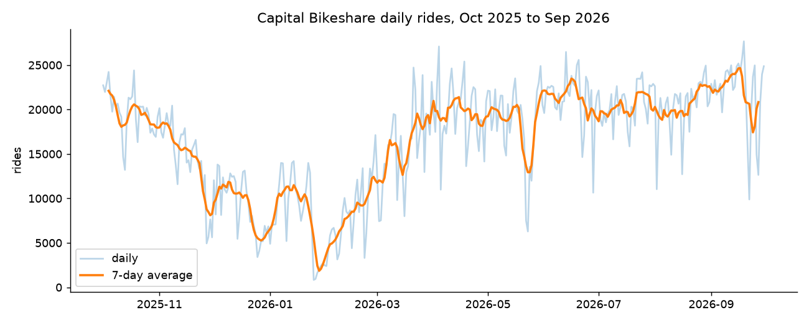
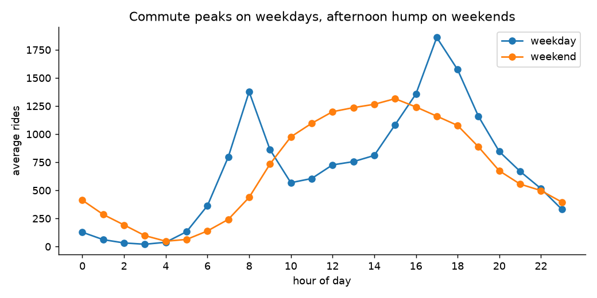
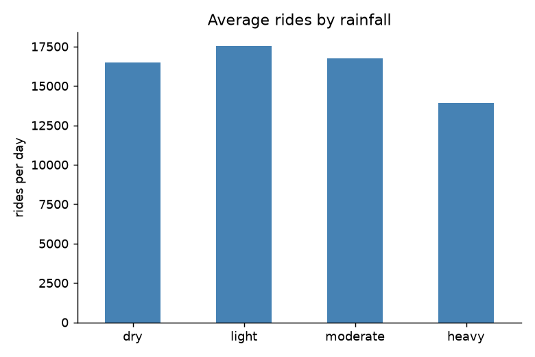
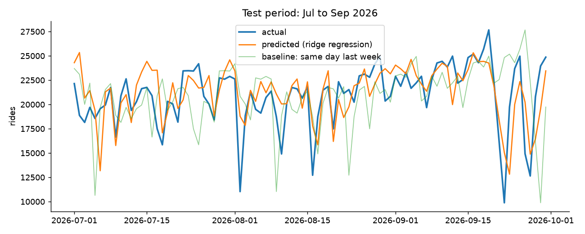

# Forecasting DC Capital Bikeshare Ridership

How much does weather, the day of the week, and the season drive bike share use in DC, and can we predict tomorrow's ride count?

Data: 12 months of public Capital Bikeshare trip data (Oct 2025 to Sep 2026, ~6 million rides) joined with daily weather from Open-Meteo.

## Why I built this
_(write 2-3 sentences here)_

## Key findings

**Season is the biggest driver.** Average daily rides range from about 8,200 in January to about 22,000 in September. Daily high temperature alone has a 0.82 correlation with ride count.



**Members commute, casual riders explore.** Casual riders make up 23.5% of rides on weekdays but 33.7% on weekends. Weekday rides peak at morning and evening rush hour; weekends have one broad afternoon hump.



**Heavy rain cuts rides, light rain barely matters.** Days with over 0.5" of rain average about 13,900 rides versus about 16,500 on dry days. Light-rain days actually look slightly busier than dry ones, but that's mostly because rain is more common in summer, when riding is high anyway.



Busiest day: Sep 19, 2026 (27,667 rides). Quietest: Jan 25, 2026 (833 rides).
Busiest start station: Columbus Circle / Union Station.

## Forecasting model

Goal: predict a day's total rides using only information available the night before (recent ride counts, calendar, weather).
Trained on Oct 2025 to Jun 2026, tested on Jul to Sep 2026.

| Model | MAE (rides) | MAPE |
|---|---|---|
| Ridge regression | 1,959 | 10.5% |
| Gradient boosting | 1,960 | 10.0% |
| Baseline: last 7-day average | 2,244 | 12.6% |
| Baseline: same day last week | 2,875 | 15.9% |

The model cuts error by about a third compared to the naive baseline. Gradient boosting didn't beat ridge regression, so the simpler model is enough here.



## Limitations
- Uses actual weather as a stand-in for a weather forecast, so real-world error would be a bit higher.
- Daily rain totals miss timing: 0.7" overnight is very different from 0.7" at 5pm rush hour. Several of the biggest misses were rainy days.
- Only one year of data, so the model has seen each season once.
- Doesn't account for events (concerts, marathons, holidays like the week of July 4).

## Run it
```
pip install -r requirements.txt
python src/download.py        # ~5 min, downloads 12 monthly files
python src/build_dataset.py
python src/explore.py
python src/model.py
```

## Next steps
- Use hourly weather to capture rain timing
- Forecast at the station level
- Add a few more years of data